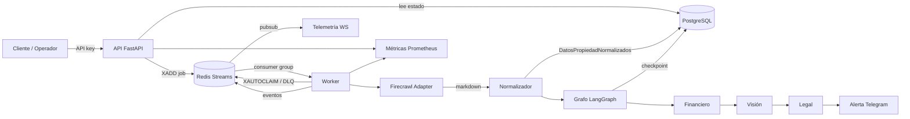

# Plan de implementación OpenClaw — equipo de 2 desarrolladores

**Versión:** 1.0 · 20 de noviembre de 2026  
**Alcance:** llevar el prototipo actual a un release candidate operable, con seguridad, persistencia y orquestación completas.  
**Duración:** 13 semanas (23 nov 2026 – 19 feb 2027) · 7 sprints.  
**Equipo:** Dev A (Plataforma) y Dev B (Dominio e IA).  
**Esfuerzo estimado:** 101 días-persona sobre una capacidad de 104.
  
---

## 1. Objetivo del plan

Al terminar la semana 13 el sistema debe poder ejecutar un barrido completo de principio a fin: recibir una orden autenticada, extraer propiedades de las plataformas habilitadas, normalizarlas y persistirlas, evaluarlas con el grafo de decisión, alertar solo al chat autorizado y dejar un historial auditable de cada decisión. El webhook financiero debe estar desactivado por defecto y, en su modo de simulación, exigir orden parametrizada, límites e idempotencia.

El plan no implementa las fases 95–104 ni 110–117. Esas quedan documentadas y estimadas al final, porque varias dependen de revisión legal y de decisiones de negocio que no están tomadas.

### Dentro del alcance

| Bloque       | Qué se entrega                                                                                                 |
| ------------ | -------------------------------------------------------------------------------------------------------------- |
| Núcleo       | Contratos validados, separación API/worker, configuración segura, health checks                                |
| Seguridad    | Autenticación de ingesta, webhook Telegram restringido, `/buy` en simulación con límites y auditoría           |
| Datos        | PostgreSQL con migraciones, jobs, propiedades, decisiones y eventos                                            |
| Ingesta      | Worker con consumer group, reintentos, dead-letter queue e idempotencia                                        |
| Dominio      | Normalizador, análisis financiero parametrizado, visión real con salida estructurada, auditoría legal asistida |
| Orquestación | Grafo LangGraph compilado, con checkpointer y trazabilidad por nodo                                            |
| Operación    | Métricas Prometheus, logs con `job_id`, telemetría WebSocket, Docker reproducible                              |

### Fuera del alcance

Tesorería DeFi, AGNET RPC, oráculo geoespacial, adquisición off-market con skip tracing, SMS y generación de contratos. Estas capacidades requieren revisión legal y de cumplimiento previa, y se abordan en la sección 9.

---

## 2. Decisiones de arranque

Estas cinco decisiones deben quedar cerradas en la semana 1 y no se reabren durante el proyecto. Cambiarlas después obliga a reescribir módulos enteros.

| ID     | Decisión                | Elegido                                                                                                                                                                           | Motivo                                                       | Se descarta                                   |
| ------ | ----------------------- | --------------------------------------------------------------------------------------------------------------------------------------------------------------------------------- | ------------------------------------------------------------ | --------------------------------------------- |
| ADR-01 | Contrato de plataformas | Catálogo cerrado de 9 claves en servidor (`zillow`, `realtor`, `redfin`, `trulia`, `loopnet`, `craigslist`, `century21`, `coldwell`, `remax`) con plantilla de URL por plataforma | Evita SSRF y permite rate limiting por dominio real          | URL libre enviada por el cliente              |
| ADR-02 | Patrón de cola          | Consumer group + `XACK` + `XAUTOCLAIM` de pendientes + stream DLQ                                                                                                                 | Garantiza entrega al menos una vez y recuperación tras caída | `XREAD` desde `0-0` con `XDEL`                |
| ADR-03 | Persistencia            | PostgreSQL 16 con SQLAlchemy 2 y Alembic; Redis solo como cola, caché y rate limit                                                                                                | Permite consultar historial y auditar decisiones             | Guardar todo en Redis                         |
| ADR-04 | Autenticación           | API key en cabecera `X-OpenClaw-Tactical-Key`, comparada con hash, con rate limit por clave                                                                                       | Simple, suficiente para un servicio interno                  | Zero-Trust completo con mTLS (fase posterior) |
| ADR-05 | Alcance de `/buy`       | `BUY_MODE=disabled` por defecto; `sandbox` exige orden con monto, destino, idempotency key y confirmación                                                                         | Elimina el riesgo de retiro fijo no autorizado               | Webhook activo con monto en código            |

---

## 3. Arquitectura objetivo

Los límites entre componentes son puertos explícitos: `ScraperPort`, `RepositoryPort`, `NotifierPort` y `ValuationPort`. Así el worker se puede probar con dobles y Firecrawl se puede sustituir sin tocar el dominio.

---

## 4. Equipo y reparto de carga

| Rol                      | Responsabilidad                                                         | Módulos                                                   | Carga                 |
| ------------------------ | ----------------------------------------------------------------------- | --------------------------------------------------------- | --------------------- |
| **Dev A — Plataforma**   | Infraestructura, API, cola, base de datos, contenedores, observabilidad | `app/api`, `app/workers`, `app/core`, `app/db`, `deploy/` | 50,5 días             |
| **Dev B — Dominio e IA** | Extracción, normalización, reglas de negocio, grafo, integraciones      | `app/services`, `app/orchestrator`, `app/integrations`    | 50,5 días             |
| **Ambos**                | Contratos, criterios de aceptación, revisión cruzada de PR              | `app/models`, pruebas E2E                                 | 3 días (1,5 cada uno) |

El reparto sigue una regla simple: **quien define un contrato no implementa los dos lados**. Dev A define la forma del job y su ciclo de vida; Dev B define el contenido de la propiedad y las reglas de decisión. Cada PR lo revisa el otro, sin excepciones.

### Capacidad

13 semanas × 5 días = 65 días por persona. Descontando ceremonias, revisión de PR y buffer del 20 %, quedan **52 días productivos por persona**. El backlog suma 101 días, por debajo de los 104 disponibles. Las semanas del 21 de diciembre y del 28 de diciembre tienen dos días menos por festivos: ese margen ya está absorbido en el buffer, pero si se pierde más, se recorta primero la telemetría y luego el panel de Dev B en el sprint 5.

---

## 5. Calendario de sprints

| Sprint | Fechas        | Foco               | Entregable demostrable                                                      |
| ------ | ------------- | ------------------ | --------------------------------------------------------------------------- |
| **S0** | 23–27 nov     | Preparación        | Repo, CI, entorno Docker, ADRs firmados, baseline de pruebas                |
| **S1** | 30 nov–11 dic | Contratos y núcleo | `POST /barridos` validado y encolado; API y worker separados; health checks |
| **S2** | 14–25 dic     | Seguridad y datos  | Ingesta autenticada, PostgreSQL con migraciones, `/buy` en simulación       |
| **S3** | 28 dic–8 ene  | Worker robusto     | Procesamiento sin pérdida con DLQ, idempotencia y deduplicación             |
| **S4** | 11–22 ene     | Orquestación       | Grafo completo ejecutando y persistiendo decisiones por propiedad           |
| **S5** | 25 ene–5 feb  | Operación          | Métricas, telemetría en vivo, despliegue reproducible, E2E                  |
| **S6** | 8–19 feb      | Hardening y RC     | Cobertura ≥ 75 %, revisión de seguridad, runbook, demo de aceptación        |

**Ceremonias:** planning el lunes (1 h), revisión de bloqueos el miércoles (30 min), demo y retrospectiva el viernes final de sprint (1 h). El resto del tiempo, foco.

---

## 6. Backlog detallado por sprint

Las estimaciones están en días-persona. La columna «Hecho cuando» es el criterio de aceptación verificable, no una descripción de la tarea.

### Sprint 0 — Preparación (5,5 días)

| ID    | Tarea                                                             | Resp. | Est. | Depende | Hecho cuando                                            |
| ----- | ----------------------------------------------------------------- | ----- | ---- | ------- | ------------------------------------------------------- |
| S0-01 | Estructura de repo, ramas y CI base (ruff, black, pytest)         | A     | 1    | —       | Un PR de prueba pasa lint y tests en CI                 |
| S0-02 | `docker-compose.dev` con Redis y PostgreSQL, `.env.example`       | A     | 1    | —       | `docker compose up` deja ambos servicios sanos          |
| S0-03 | ADR-01 a ADR-05 redactados y firmados                             | B     | 1    | —       | Los cinco ADR están en `docs/adr/` y aprobados          |
| S0-04 | Baseline de pruebas: `pytest-asyncio`, `fakeredis`, cliente httpx | B     | 1    | S0-01   | Existe una prueba de humo que valida `/health`          |
| S0-05 | Migrar configuración a `pydantic-settings` y quitar hardcodes     | A     | 1    | S0-02   | Ningún secreto ni URL queda en el código                |
| S0-06 | Guion de reproducción del flujo actual                            | B     | 0,5  | —       | Un script levanta el flujo actual y documenta su salida |

### Sprint 1 — Contratos y núcleo (20 días)

| ID    | Tarea                                                        | Resp. | Est. | Depende | Hecho cuando                                                       |
| ----- | ------------------------------------------------------------ | ----- | ---- | ------- | ------------------------------------------------------------------ |
| S1-01 | Settings validados al arranque con fallo rápido              | A     | 1    | S0-05   | Arrancar sin `OPENCLAW_API_KEY` falla con mensaje claro            |
| S1-02 | Modelos `BarridoRequest`, `JobResponse`, `ErrorResponse`     | A+B   | 2    | S0-03   | Contratos publicados en OpenAPI y cubiertos por pruebas            |
| S1-03 | `POST /v1/openclaw/barridos` con validación y `job_id`       | A     | 2    | S1-02   | Payload incompleto devuelve 400; válido devuelve 202 con id        |
| S1-04 | `GET /v1/openclaw/barridos/{job_id}` con estado              | A     | 2    | S1-03   | Devuelve `queued` y 404 para id inexistente                        |
| S1-05 | Entrypoints separados API/worker y `Dockerfile` multi-target | A     | 2    | S0-02   | Dos contenedores arrancan desde la misma imagen                    |
| S1-06 | Logging estructurado con `job_id` y `trace_id`               | A     | 1    | S1-03   | Cada línea de log de un job incluye su identificador               |
| S1-07 | Catálogo de 9 plataformas con plantillas y validación        | B     | 1,5  | S0-03   | Clave desconocida devuelve 422 con lista de válidas                |
| S1-08 | `ScraperPort` + `FirecrawlAdapter` con timeout y backoff     | B     | 2    | S0-04   | Prueba con fallo simulado agota reintentos y devuelve error tipado |
| S1-09 | Rate limiter de ventana deslizante, política fail-closed     | B     | 1,5  | S0-02   | Superar el límite devuelve `rate_limited`; Redis caído bloquea     |
| S1-10 | Pruebas de contrato del scraper con cassettes                | B     | 2    | S1-08   | La suite corre sin red y cubre éxito, bloqueo y timeout            |
| S1-11 | Normalizador: markdown a `DatosPropiedadNormalizados`        | B     | 3    | S1-07   | 20 fixtures producen objetos válidos; los incompletos se rechazan  |

### Sprint 2 — Seguridad y datos (17,5 días)

| ID    | Tarea                                                                                     | Resp. | Est. | Depende      | Hecho cuando                                                      |
| ----- | ----------------------------------------------------------------------------------------- | ----- | ---- | ------------ | ----------------------------------------------------------------- |
| S2-01 | Dependencia de autenticación por API key con hash                                         | A     | 1,5  | S1-01        | Sin clave devuelve 401; clave inválida 403; clave válida pasa     |
| S2-02 | Esquema PostgreSQL y migraciones Alembic (`jobs`, `propiedades`, `decisiones`, `eventos`) | A     | 3    | S1-05        | `alembic upgrade head` crea el esquema desde cero                 |
| S2-03 | Repositorios y unidad de trabajo por mensaje                                              | A     | 2    | S2-02        | Una transacción por propiedad; rollback deja estado consistente   |
| S2-04 | Datos semilla del catálogo de plataformas                                                 | A     | 1    | S2-02        | Migración de datos idempotente                                    |
| S2-05 | Webhook Telegram con `secret_token`, allowlist y dedupe de `update_id`                    | A     | 1,5  | S2-01        | Update repetido se ignora; chat no autorizado devuelve 403        |
| S2-06 | Cierre del normalizador con fixtures reales                                               | B     | 2    | S1-11        | Cobertura del normalizador ≥ 85 %                                 |
| S2-07 | `/buy` en modo simulación con límites, idempotencia y auditoría                           | B     | 3    | S2-01, S2-02 | Doble envío con misma clave ejecuta una sola vez y queda auditado |
| S2-08 | Cliente UAO con timeout, reintentos y circuit breaker                                     | B     | 1,5  | S2-07        | Fallo del proveedor no bloquea el worker ni pierde la orden       |
| S2-09 | Pruebas de seguridad: auth, payload inválido, replay, idempotencia                        | B     | 2    | S2-05, S2-07 | Suite dedicada en CI, sin red                                     |

### Sprint 3 — Worker robusto (17 días)

| ID    | Tarea                                                        | Resp. | Est. | Depende | Hecho cuando                                                   |
| ----- | ------------------------------------------------------------ | ----- | ---- | ------- | -------------------------------------------------------------- |
| S3-01 | Consumer group con `XAUTOCLAIM`, reintentos y DLQ            | A     | 3    | S2-03   | Matar el worker a mitad de proceso no pierde el mensaje        |
| S3-02 | Idempotencia por `job_id` + plataforma                       | A     | 1,5  | S3-01   | Reprocesar el mismo mensaje no duplica propiedades             |
| S3-03 | Máquina de estados del job con transiciones válidas          | A     | 2    | S2-03   | Transición ilegal lanza error y no corrompe el estado          |
| S3-04 | Semáforo de concurrencia por dominio                         | A     | 1,5  | S3-01   | 50 mensajes de Zillow no exceden el límite configurado         |
| S3-05 | Enriquecimiento: precio, superficie, año, HOA desde markdown | B     | 3    | S2-06   | 20 anuncios reales extraen los cuatro campos o marcan ausencia |
| S3-06 | Geocodificación opcional con caché en Redis                  | A     | 2    | S3-05   | Segunda consulta de la misma dirección no llama al proveedor   |
| S3-07 | Deduplicación por dirección normalizada y similitud          | B     | 2    | S3-05   | Dos anuncios de la misma casa quedan como una propiedad        |
| S3-08 | Pruebas de resiliencia del worker                            | B     | 2    | S3-01   | Cubre pérdida, reintento, DLQ y duplicados                     |

### Sprint 4 — Orquestación (17 días)

| ID    | Tarea                                                           | Resp. | Est. | Depende | Hecho cuando                                                             |
| ----- | --------------------------------------------------------------- | ----- | ---- | ------- | ------------------------------------------------------------------------ |
| S4-01 | Grafo LangGraph tipado con aristas condicionales y checkpointer | A     | 3    | S3-03   | Un estado de prueba recorre el grafo y queda checkpoint                  |
| S4-02 | Integración worker → grafo por propiedad normalizada            | A     | 2    | S4-01   | Cada propiedad procesada genera una fila en `decisiones`                 |
| S4-03 | Reintento por nodo y dead-letter de decisiones fallidas         | A     | 1,5  | S4-02   | Un nodo que falla dos veces queda en DLQ con motivo                      |
| S4-04 | Nodo financiero parametrizado desde configuración               | B     | 2    | S4-01   | Cambiar tasas en config altera el cap rate sin tocar código              |
| S4-05 | Nodo de visión con LLM multimodal y salida estructurada         | B     | 4    | S4-01   | Devuelve CAPEX, confianza y motivo; sin imágenes marca «no disponible»   |
| S4-06 | Nodo de auditoría legal asistida                                | B     | 3    | S4-01   | Detecta señales de liens y back taxes; toda alerta exige revisión humana |
| S4-07 | Nodo de alerta con plantilla, dedupe y enlace a ficha           | B     | 1,5  | S4-02   | Una oportunidad genera una sola alerta y apunta a su ficha               |

### Sprint 5 — Operación (13,5 días)

| ID    | Tarea                                                                       | Resp. | Est. | Depende | Hecho cuando                                                 |
| ----- | --------------------------------------------------------------------------- | ----- | ---- | ------- | ------------------------------------------------------------ |
| S5-01 | Métricas Prometheus: jobs, latencia por etapa, rechazos, profundidad de DLQ | A     | 2    | S3-01   | `/metrics` expone las cuatro métricas y hay panel de ejemplo |
| S5-02 | Telemetría WebSocket con autenticación y backpressure                       | A     | 3    | S5-01   | Un cliente lento se desconecta sin afectar al worker         |
| S5-03 | `docker-compose.prod`, healthchecks y guía de despliegue                    | A     | 2    | S1-05   | Despliegue desde cero en máquina limpia en menos de 30 min   |
| S5-04 | Panel mínimo de jobs y telemetría                                           | B     | 2    | S5-02   | Lista jobs con estado y permite ver el detalle de uno        |
| S5-05 | Suite E2E con Firecrawl simulado y prueba real nocturna                     | B     | 3    | S4-07   | Un barrido completo termina en `completed` sin intervención  |
| S5-06 | Prueba de carga controlada                                                  | B     | 1,5  | S5-05   | 100 jobs sin errores no controlados; latencia reportada      |

### Sprint 6 — Hardening y release candidate (10,5 días)

| ID    | Tarea                                                 | Resp. | Est. | Depende | Hecho cuando                                                      |
| ----- | ----------------------------------------------------- | ----- | ---- | ------- | ----------------------------------------------------------------- |
| S6-01 | Cobertura ≥ 75 %, lint estricto y `mypy` en el núcleo | A     | 2    | S5-05   | CI falla por debajo del umbral                                    |
| S6-02 | Revisión de seguridad contra OWASP API Top 10         | B     | 2    | S5-03   | Checklist cerrado con hallazgos y su resolución                   |
| S6-03 | README operativo, runbook de incidentes y ADR finales | A     | 2    | S5-03   | Un tercero puede operar el sistema siguiendo el runbook           |
| S6-04 | Ensayo de release en entorno limpio                   | A     | 1,5  | S6-03   | Despliegue, barrido y alerta funcionan sin pasos manuales ocultos |
| S6-05 | Backlog de fases 95–104 priorizado y estimado         | B     | 2    | —       | Cada módulo tiene tamaño, dependencia y requisito legal           |
| S6-06 | Demo de aceptación contra los ocho criterios          | A+B   | 1    | S6-04   | Los ocho criterios se demuestran en vivo                          |

---

## 7. Ruta crítica

Cinco cadenas determinan la fecha final. Si una se retrasa, el release se retrasa.

| Cadena                           | Secuencia                             | Holgura |
| -------------------------------- | ------------------------------------- | ------- |
| Contratos → API → worker         | S1-02 → S1-03 → S2-02 → S3-01 → S4-02 | 2 días  |
| Autenticación → webhook → `/buy` | S2-01 → S2-05 → S2-07                 | 3 días  |
| Normalizador → grafo → alerta    | S1-11 → S2-06 → S4-01 → S4-07 → S5-05 | 1 día   |
| Visión                           | S4-01 → S4-05                         | 4 días  |
| Despliegue → E2E                 | S5-03 → S5-05 → S6-04                 | 2 días  |

El camino más ajustado es la cadena del normalizador: cualquier retraso en S1-11 se propaga hasta el E2E. Por eso S1-11 arranca antes de cerrar el sprint 1 y S2-06 lo termina en la primera semana del sprint 2.

---

## 8. Calidad, revisión y definición de terminado

| Práctica    | Regla                                                                                    |
| ----------- | ---------------------------------------------------------------------------------------- |
| Ramas       | Trunk-based: rama corta por tarea (`feat/S3-01-worker-dlq`), vida máxima 3 días          |
| PR          | Máximo 400 líneas; revisión del otro dev en menos de 24 h; CI verde obligatorio          |
| Pruebas     | Unitarias por módulo, integración con `fakeredis` y Postgres en contenedor, E2E al final |
| Cobertura   | 60 % al cierre del sprint 2, 70 % en el 4, 75 % en el 6                                  |
| Tipado      | `mypy` en `app/core`, `app/models`, `app/orchestrator` desde el sprint 4                 |
| Migraciones | Toda tabla nueva entra con migración y prueba de upgrade desde cero                      |
| Secretos    | Solo por entorno; el repo no contiene claves ni valores por defecto utilizables          |

**Definición de terminado de una tarea:** código en `main`, pruebas que cubren el criterio de aceptación, documentación mínima en el módulo, sin `TODO` sin ticket y revisada por el otro desarrollador. Una tarea sin criterio verificable no entra al sprint.

---

## 9. Riesgos del plan

| Riesgo                                            | Prob. | Impacto | Mitigación                                                                             |
| ------------------------------------------------- | ----- | ------- | -------------------------------------------------------------------------------------- |
| Firecrawl cambia su API o limita la cuenta        | Media | Alto    | `ScraperPort` aísla el cambio; cassettes permiten trabajar sin red                     |
| Bloqueo de plataformas por volumen de solicitudes | Media | Medio   | Rate limit por dominio, horarios y límites de concurrencia; nunca evasión de controles |
| La visión con LLM resulta imprecisa               | Alta  | Medio   | Salida estructurada con confianza y umbral; se degrada a «no disponible»               |
| Festivos de diciembre reducen capacidad           | Alta  | Medio   | Buffer del 20 %; se recorta telemetría y panel antes que núcleo                        |
| Cambio de alcance hacia fases 95–117              | Media | Alto    | Congelar alcance al firmar los ADR; lo nuevo entra al backlog de S6-05                 |
| Requisitos legales de skip tracing o DeFi         | Media | Alto    | Fuera de alcance; revisión legal antes de estimar                                      |

---

## 10. Fuera de alcance y puerta legal

Los módulos de las fases 95–104 y 110–117 no se implementan en estas 13 semanas. Tres de ellos no son decisiones técnicas: adquisición off-market con skip tracing y SMS, tesorería DeFi y liquidación on-chain con EIP-712. Antes de estimarlos hace falta una revisión legal que determine base de licitud del tratamiento de datos, consentimiento para mensajería, y tratamiento contable y regulatorio de fondos en custodia.

La tarea S6-05 deja ese backlog priorizado y con el requisito legal identificado por módulo, para que la siguiente planificación no empiece de cero.

---

## 11. Primeros tres días

| Día          | Dev A                      | Dev B                       |
| ------------ | -------------------------- | --------------------------- |
| Lunes 23     | S0-01 estructura y CI      | S0-03 ADR-01 a ADR-05       |
| Martes 24    | S0-02 Docker de desarrollo | S0-04 baseline de pruebas   |
| Miércoles 25 | S0-05 configuración tipada | S0-06 guion de reproducción |

Al cierre del miércoles deben estar firmados los cinco ADR, porque el jueves empieza el diseño de contratos y cualquier cambio posterior obliga a rehacer S1-02, S1-03 y S2-02.

---

## 12. Cómo usar este plan

El backlog importable está en `BACKLOG_OPENCLAW_2DEVS.csv`, con una fila por tarea y columnas compatibles con Jira, Linear o Trello. Cada sprint se planifica tomando las filas de su columna `Sprint` y verificando que la suma de estimaciones no exceda la capacidad de 8 días por persona y semana.

El plan se revisa al final de cada sprint. Si la velocidad real difiere más de un 20 % de la estimada, se reajusta el alcance de los sprints 5 y 6, nunca el de los sprints 1 a 3, porque esos sostienen la seguridad y la trazabilidad del sistema.
